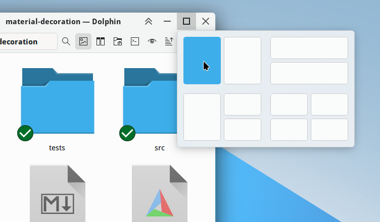

# material-decoration

Material-ish window decoration theme for KWin

### Locally Integrated Menu & Search

This hides the AppMenu icon button and draws the menu in the titlebar. It also
includes a search button to find actions. It works on both X11 and Wayland. On
Wayland, GTK apps don't export the menu in a KDE-friendly way. You need to
start them with `GDK_BACKEND=x11` environment variable or you can try the
experimental 
[appmenu-gtk-module-wayland](https://github.com/guiodic/appmenu-gtk-module-wayland)
(GTK3 only).

Hold `Alt` to show menu mnemonics; press the indicated letter to open a menu.

### Configuration

Make sure you add the AppMenu button in System Settings > Colors & Themes >
Window Decorations > Configure Titlebar Buttons….

There, by clicking the pencil icon that is displayed when you select the
Material theme, you can modify various aspects of the decoration, both in terms
of appearance and behaviour. For example, you can transform it into a hamburger
menu, disable the search function, and even decide whether to include inactive
actions (those that are greyed out) in the search results.

Note: if you configure the decoration to use Opacity < 100%, 
[Better Blur effect](https://github.com/xarblu/kwin-effects-better-blur-dx) is
strongly recommended on Wayland.

### Actions on Press-and-Hold buttons

Pressing and holding the “Close” button will minimize the window to the traybar
if the [kwin-minimize2tray](https://github.com/luisbocanegra/kwin-minimize2tray)
script is present and enabled ( 
[AUR package](https://aur.archlinux.org/packages/kwin-minimize2tray-git)).

On Plasma 6.6, pressing and holding the "Minimize" button will minimize ALL
windows but the active one on Plasma 6.6 (Wayland). This requires MinimizeAll
script (please enable it in System Settings). For X11, please copy the
directory `/usr/share/kwin-wayland/scripts/minimizeall` to `
/usr/share/kwin-x11/scripts/minimizeall`

### Tiling layout popup

Hold the **Maximize** button with the left mouse button to open the tiling
selector.

In **Button options**, you can also enable opening the popup by hovering over
Maximize/Restore.

The bottom-left preview shows the current monitor's custom layout (Meta+T).



The popup uses a companion **Material Tiling Popup** KWin script for native
quick tiling. The script is enabled by default unless explicitly disabled in
**System Settings > Window Management > KWin Scripts**.
If the script was disabled, enable it in that panel.

After the first installation, log out and log back in so KWin discovers and
loads the companion script.

# Build instructions for Plasma 6

Requires a C++20 compiler, CMake, extra-cmake-modules, Qt 6, KDE Frameworks 6
and KDecoration3.

Optional: `libwayland` development files, `wayland-scanner` and
`plasma-wayland-protocols` ≥ 1.15 enable showing menu mnemonics while holding
`Alt` on Wayland. Without them, menu shortcuts still work.
These optional packages are not needed with `-DFORCE_X11=ON`.

### Debian / Ubuntu

Use a release that provides KDecoration3 and the Plasma version supported by this branch.

```sh
sudo apt install build-essential cmake extra-cmake-modules gettext git \
  qt6-base-dev qt6-declarative-dev qt6-tools-dev libkdecorations3-dev \
  libkf6config-dev libkf6configwidgets-dev libkf6coreaddons-dev \
  libkf6guiaddons-dev libkf6i18n-dev libkf6iconthemes-dev \
  libkf6kcmutils-dev libkf6service-dev libkf6widgetsaddons-dev \
  libkf6windowsystem-dev libx11-dev libxcb1-dev
```

Optional, for Wayland Alt monitoring:

```sh
sudo apt install libwayland-dev libwayland-bin plasma-wayland-protocols
```

### Fedora

```sh
sudo dnf install gcc-c++ make cmake extra-cmake-modules gettext git \
  qt6-qtbase-devel qt6-qtdeclarative-devel qt6-qttools-devel kdecoration-devel \
  kf6-kconfig-devel kf6-kconfigwidgets-devel kf6-kcoreaddons-devel \
  kf6-kguiaddons-devel kf6-ki18n-devel kf6-kiconthemes-devel \
  kf6-kcmutils-devel kf6-kservice-devel kf6-kwidgetsaddons-devel \
  kf6-kwindowsystem-devel libX11-devel libxcb-devel vulkan-headers
```
### Arch and derivatives

Please install the AUR package 
[material-kwin-decoration-git](https://aur.archlinux.org/packages/material-kwin-decoration-git)

On Arch Linux, the package dependencies are:

- Runtime: `kwin`, plus `wayland` when Wayland Alt monitoring is compiled in.
- Build: `base-devel`, `cmake`, `extra-cmake-modules`, `git`, `vulkan-headers`;
  add `plasma-wayland-protocols` ≥ 1.15 and `wayland` for Wayland Alt monitoring.
  The `wayland` package includes the development files and `wayland-scanner`.
- Optional: `plasma-x11-session` for X11;
  `appmenu-gtk-module` for GTK menus on X11 or `appmenu-gtk-module-wayland` on Wayland;
  `kwin-minimize2tray-git` for the Close button's long-press action;
  `kwin-effects-better-blur-dx` for translucent titlebars on Wayland.

Optional, for Wayland Alt monitoring:

```sh
sudo dnf install wayland-devel plasma-wayland-protocols
```

### Compile and install

```
git clone https://github.com/guiodic/material-decoration.git
cd material-decoration
mkdir build
cmake -B build . # add this for SonicDE: -DFORCE_X11=ON
cmake --build build -j$(nproc)
sudo cmake --install build
```


NOTE 1: the master branch is aligned with the latest Plasma version. For earlier
ones, see the other branches.

NOTE 2: After 5 August 2026 the Decoration Id changed, please select again Material in Systemsettings, if needed.
