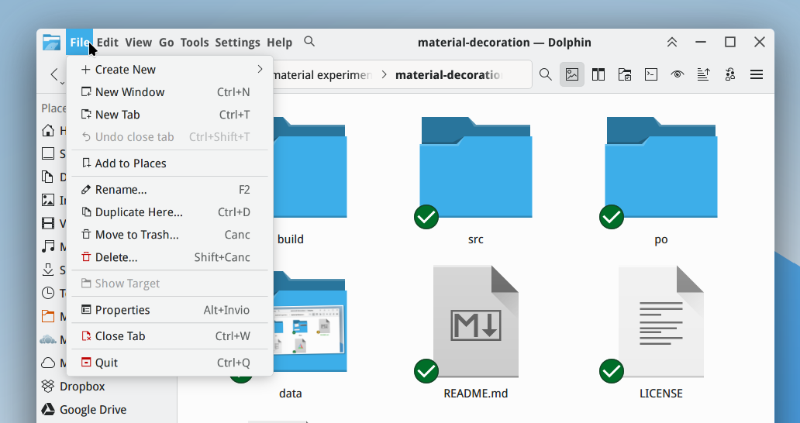

# material-decoration

Material-ish window decoration theme for KWin

### Locally Integrated Menu & Search

This hides the AppMenu icon button and draws the menu in the titlebar. It also
includes a search button to find actions. It works on both X11 and Wayland. On
Wayland, GTK apps don't export the menu in a KDE-friendly way. You need to
start them with `GDK_BACKEND=x11` environment variable or you can try the
experimental 
[appmenu-gtk-module-wayland](https://github.com/guiodic/appmenu-gtk-module-wayland)
(GTK3 only).

### Configuration

Make sure you add the AppMenu button in System Settings > Colors & Themes >
Window Decorations > Configure Titlebar Buttons….

There, by clicking the pencil icon that is displayed when you select the
Material theme, you can modify various aspects of the decoration, both in terms
of appearance and behaviour. For example, you can transform it into a hamburger
menu, disable the search function, and even decide whether to include inactive
actions (those that are greyed out) in the search results.

Note: if you configure the decoration to use Opacity < 100%, 
[Better Blur effect](https://github.com/xarblu/kwin-effects-better-blur-dx) is
strongly recommended on Wayland.

### Tiling layout popup

Hold the **Maximize** button with the left mouse button to open the tiling
selector. Release the button, then click a zone to tile that window. A short
click keeps the usual maximize/restore behavior; middle and right clicks keep
KWin's configured actions. The existing long-press setting and delay apply.

The first version offers side-by-side halves, top/bottom halves, a left half
with two right quarters, and four quarters. Only the selected window moves;
other windows are not automatically arranged. Use the arrow keys and Enter or
Space to select a zone, or Escape/click outside to cancel.

This uses KWin's native quick tiling, including its work area, size constraints
and restore behavior. The target is identified by its decoration, rather than
by the currently active window. It is available in the KWin Wayland build
(including XWayland windows); the separate `FORCE_X11` build currently keeps the
normal maximize action. The implementation uses KWin C++ APIs and must be built
against the running KWin version. Arbitrary ratios and custom tiling layouts
are not included yet.

To run the popup interaction tests after configuring CMake:

```sh
cmake -S . -B build -DBUILD_TESTING=ON
cmake --build build -j4
ctest --test-dir build --output-on-failure
```

For a desktop check, enable Material and long presses, then try a short click,
a long press followed by release, selecting each zone, and cancelling the popup.
Also check inactive and maximized windows, non-resizable windows, dragging out
of the button before the timeout, and monitors with different scaling factors.

### Actions on Press-and-Hold buttons

Pressing and holding the “Close” button will minimize the window to the traybar
if the [kwin-minimize2tray](https://github.com/luisbocanegra/kwin-minimize2tray)
script is present and enabled ( 
[AUR package](https://aur.archlinux.org/packages/kwin-minimize2tray-git)).

On Plasma 6.6, pressing and holding the "Minimize" button will minimize ALL
windows but the active one on Plasma 6.6 (Wayland). This requires MinimizeAll
script (please enable it in System Settings). For X11, please copy the
directory `/usr/share/kwin-wayland/scripts/minimizeall` to `
/usr/share/kwin-x11/scripts/minimizeall`

# Build instructions for Plasma 6

```
git clone https://github.com/guiodic/material-decoration.git
cd material-decoration
mkdir build
cmake -B build . # add this for SonicDE: -DFORCE_X11=ON
cmake --build build -j$(nproc)
sudo cmake --install build
```
for Arch and derivatives, please install the AUR package 
[material-kwin-decoration-git](https://aur.archlinux.org/packages/material-kwin-decoration-git)

NOTE 1: the master branch is aligned with the latest Plasma version. For earlier
ones, see the other branches.

NOTE 2: After 5 August 2026 the Decoration Id changed, please select again Material in Systemsettings, if needed.


....

TODO/Bugs ([Issue #1](https://github.com/Zren/material-decoration/issues/1)):

* Open Submenu on Shortcut (eg: `Alt+F`)
* Display mnemonics when holding `Alt`
